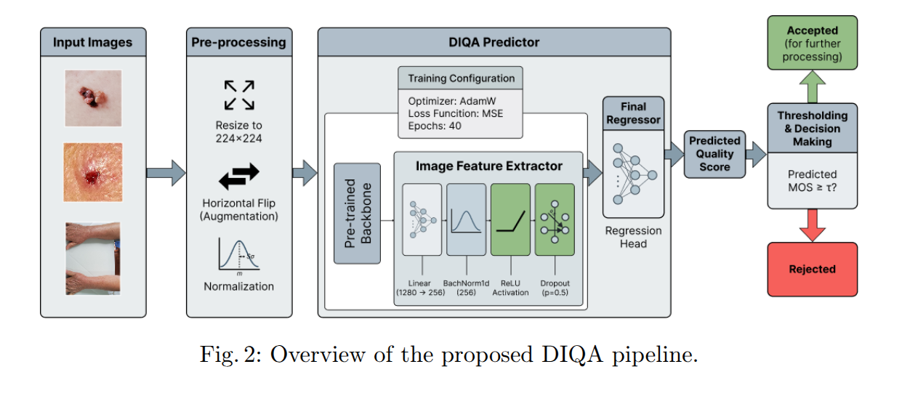
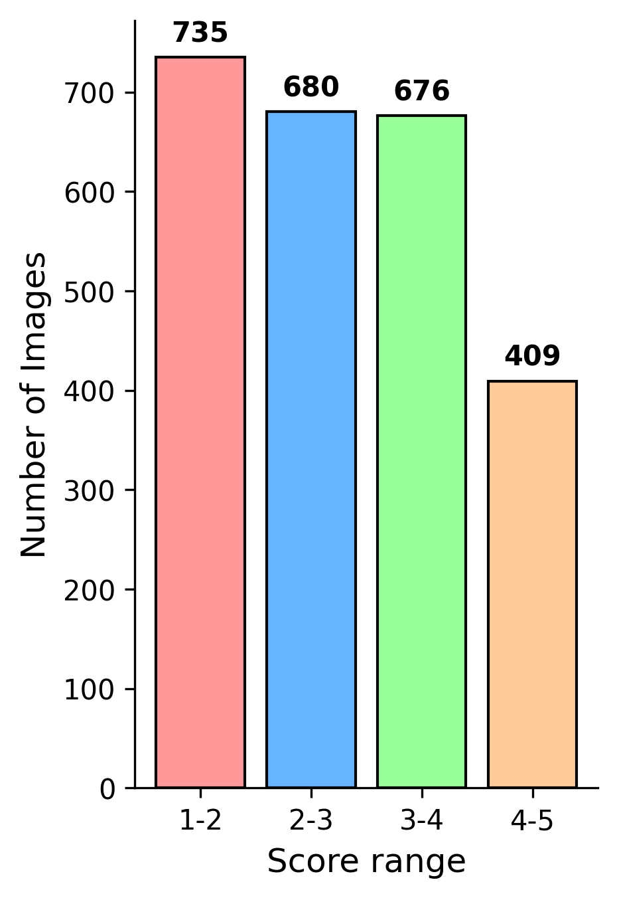
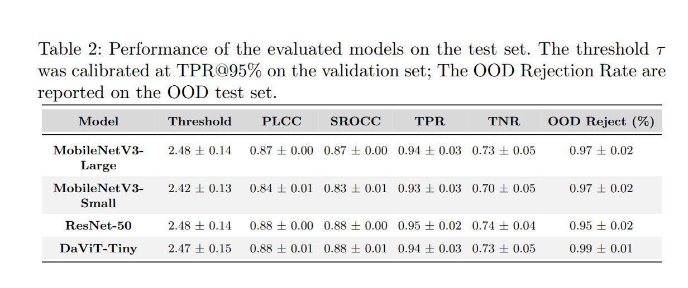

# An Open Dataset and Lightweight Model for Dermatological Image Quality Assessment

PAD-DIQA is the first publicly available dermatological image quality assessment (DIQA) dataset annotated with continuous Mean Opinion Scores (MOS). This repository provides the dataset, annotation protocol and source code presented in the paper:

Download paper: *soon*

The goal of this repository is to support reproducible research on dermatological image quality assessment and quality-aware AI pipelines for skin lesion analysis.


## Dataset and Annotation Protocol

The dataset consists of 2,500 clinical images of skin lesions annotated with Mean Opinion Scores (MOS) by up to six independent observers. The image quality assessment protocol is based on the following criteria:

- Blur / Focus
- Brightness
- Distance
- Framing
- Interference
- General Perception

**📥 Dataset Download**

- Access the full dataset: [PAD-DIQA on Mendeley Data](https://data.mendeley.com/datasets/yn4f8nccyt/1)

## Model

<div align="center">
  
</div>


## 💻 How to use
At first, you need to create a file called `config.json`:
```json
{
  "dataset_pad_diqa": "path/to/pad_diqa_dataset",
  "ood_path": "path/to/ood_dataset",
  "another_dataset_test": "path/to/another_dataset_test",
  "model_checkpoint_path": "path/to/ckpt.pth",
  "save_folder_full_path": "path/to/save_folder"
}
```

The repository uses [Sacred](https://sacred.readthedocs.io/en/latest/quickstart.html) library to run the experiments. Consult the documentation to better understand how it works. To run the experiments in this repository, using the library's basic features is sufficient. An example of execution is:
```bash
python main.py with _use_ood_in_test=True _model='mobilenet_v3_large'
```
The following parameters are available:
- `_use_ood_in_test`: when enabled, it includes OOD images from the dataset specified in the configuration in the test set.
- `_use_another_dataset`: When enabled, another set of images will be used for the test, with the path to the images specified in the configuration file.
- `_model`: set the pre-trained backbone to use in the experiment.

## 📈 Results

### General Perception MOS Distribution

<div align="center">
  
</div>

### Metrics

<div align="center">
  
</div>
